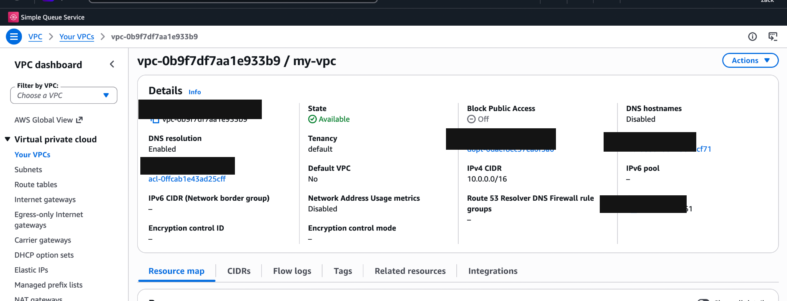
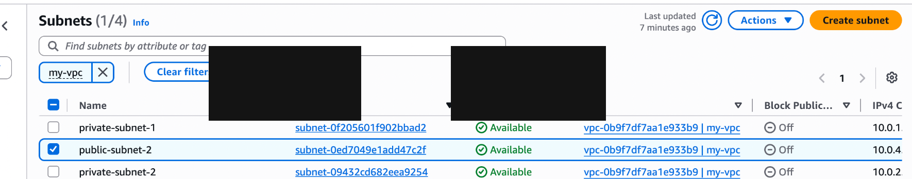
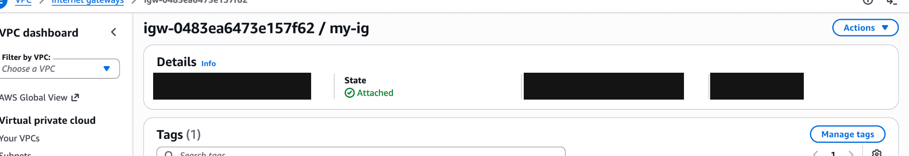
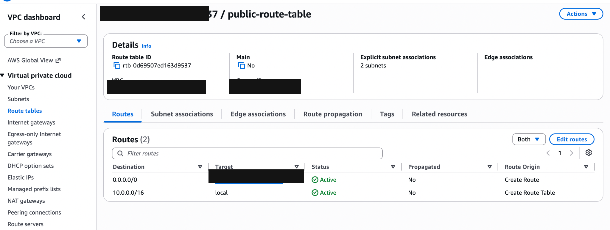
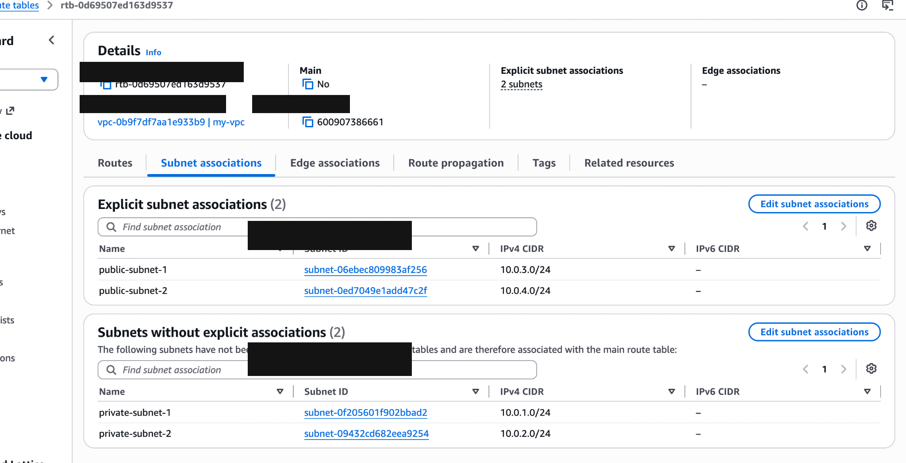

# AWS VPC Networking Project

## Overview

This hands-on project demonstrates how to build and configure an Amazon Virtual Private Cloud (VPC) using the AWS Management Console. It focuses on subnet design, Availability Zones, internet connectivity, route tables, and foundational network security concepts.

The project is part of my practical learning journey towards a career in cloud engineering.

## Architecture

The VPC is configured in the AWS Europe (London) Region (`eu-west-2`).

| Component | Configuration |
|---|---|
| VPC | `my-vpc` |
| IPv4 CIDR | `10.0.0.0/16` |
| Private subnet 1 | `10.0.1.0/24` |
| Private subnet 2 | `10.0.2.0/24` |
| Public subnet 1 | `10.0.3.0/24` |
| Public subnet 2 | `10.0.4.0/24` |
| Availability Zones | `eu-west-2a` and `eu-west-2b` |
| Internet Gateway | `my-ig` |
| Public route table | `public-route-table` |
| Default internet route | `0.0.0.0/0` → Internet Gateway |

The four subnets are distributed across two Availability Zones to practise designing for availability and resilience.

## Implementation

- Created a custom VPC with an IPv4 CIDR block.
- Created two private and two public subnets.
- Distributed the subnets across two Availability Zones.
- Created and attached an Internet Gateway.
- Configured a public route table with a default route to the Internet Gateway.
- Associated both public subnets with the public route table.
- Reviewed the relationship between subnet routing, security groups, and network ACLs.

**Note:** Public subnet configuration does not by itself prove end-to-end internet connectivity. Further testing with a suitable compute resource is a potential next step.

## Evidence and Screenshots

The screenshots below document the AWS configuration completed so far.

### 1. VPC Configuration

Shows the VPC, IPv4 CIDR block, and configuration details.

### 2. Subnets

Shows the two public and two private subnets and their CIDR ranges.

### 3. Internet Gateway

Shows the Internet Gateway attached to the VPC.

### 4. Public Route Table

Shows the default route (`0.0.0.0/0`) targeting the Internet Gateway.

### 5. Subnet Associations

Shows both public subnets associated with the public route table. The private subnets use the VPC's main route table.

## Security Concepts Learned

### Security Groups

Security groups act as stateful virtual firewalls associated with resources such as EC2 instances. They use allow rules to control inbound and outbound traffic.

### Network ACLs

Network access control lists (network ACLs) operate at the subnet level. They are stateless and evaluate inbound and outbound traffic independently.

### AWS Shared Responsibility Model

AWS is responsible for security **of** the cloud, including the underlying physical infrastructure. The customer is responsible for security **in** the cloud, including appropriate network configuration, access permissions, and resource protection.

## Skills Practised

- Amazon VPC fundamentals
- IPv4 CIDR addressing and subnetting
- Public and private subnet design
- AWS Availability Zones
- Internet Gateway configuration
- Route tables and subnet associations
- Foundational AWS network security
- Technical documentation using GitHub

## Next Steps

- Review and document security group and network ACL rules.
- Explore private subnet outbound connectivity using a NAT Gateway.
- Deploy a test EC2 instance and verify connectivity.
- Investigate infrastructure as code using Terraform.

---

*This is a learning project. The documentation reflects the configuration completed so far; planned items will be updated as the project progresses.*
